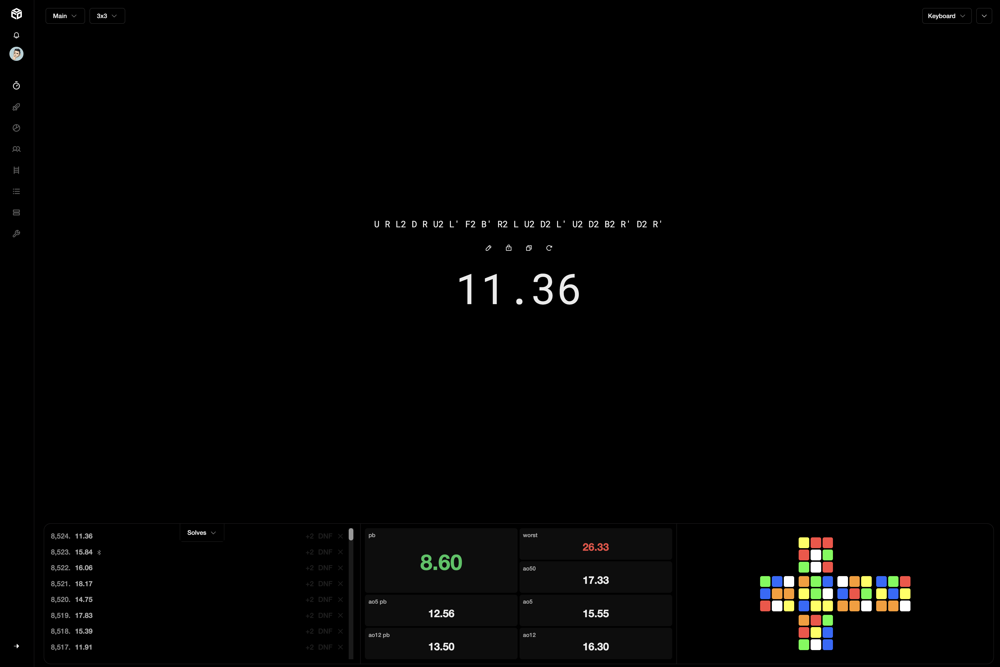

# CubeDesk

[CubeDesk](https://cubedesk.io) is a free, open-source app for [speedcubers](https://en.wikipedia.org/wiki/Speedcubing). Track your times, see your stats, train hundreds of algorithms, and race other cubers 1v1.



## Community

Come say hi on [Discord](https://discord.gg/wdVbhDnsQV). It's the best place for questions, feedback, and feature ideas.

Found a bug? [Open an issue](https://github.com/kash/cubedesk/issues/new) with the `bug` label.

## Contributing

Contributions are welcome, thank you for helping out!

- For anything bigger than a small fix, check in on Discord or open an issue first so we can agree on the approach.
- Keep pull requests focused on one change.
- Run the app and test your change yourself before opening a PR, and make sure you understand every line you're submitting.

## Running locally

You'll need Node 24 and either Docker or Postgres and Redis already running. On Linux, the setup script installs everything for you.

```sh
git clone https://github.com/kash/cubedesk.git
cd cubedesk
bash scripts/dev-setup.sh
pnpm dev
```

Open [localhost:3000](http://localhost:3000) and log in as `agent@cubedesk.test` with the password `cubedesk`. The setup script installs dependencies, creates `.env`, sets up the database, and seeds it with demo accounts, solves, friends, and 1v1 history.

To add about 4,000 sample solves to an account you created locally:

```sh
pnpm seed:dev --username YOUR_USERNAME
```

To reset the database and start over:

```sh
pnpm exec prisma migrate reset --force && pnpm seed:dev
```

The seed script only runs against a local development database.

## Deployment

Pushing to `main` deploys to production on ECS Fargate through GitHub Actions. `pnpm build` builds the client into `dist/` and the server into `build/server/`, and `pnpm start` runs the built server. Production environment variables live in the ECS task definition. The `SENTRY_AUTH_TOKEN` secret uploads source maps during the build, and `SENTRY_DSN` turns on backend error reporting at runtime.

## License

CubeDesk is licensed under the [GPL v3 or later](LICENSE.md). You're free to use it, but anything you build on it must also be open source.

I chose this license so the cubing community can build on each other's work.
